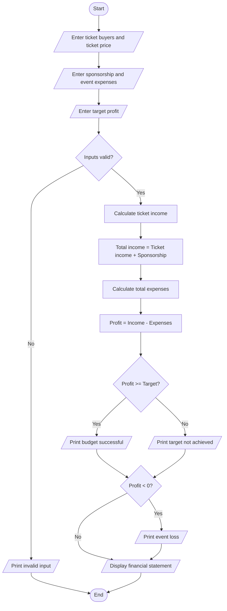

students = int(input("Enter number of ticket buyers: "))
ticket_price = float(input("Enter ticket price: "))
sponsorship = float(input("Enter sponsorship amount: "))
venue = float(input("Enter venue cost: "))
food = float(input("Enter food cost: "))
decoration = float(input("Enter decoration cost: "))
other = float(input("Enter other expenses: "))
target = float(input("Enter target profit: "))

if (min(ticket_price, sponsorship, venue, food,
        decoration, other, target) < 0 or students < 0):
    print("Invalid input")
else:
    ticket_income = students * ticket_price
    total_income = ticket_income + sponsorship
    total_expense = venue + food + decoration + other
    profit = total_income - total_expense

    print("Ticket income:", ticket_income)
    print("Total income:", total_income)
    print("Total expenses:", total_expense)
    print("Event profit:", profit)

    if profit >= target:
        print("Event budget successful")
    else:
        print("Event profit target not achieved")
             if profit < 0:
        print("Event resulted in a loss")
 Algorithm
1. Start.
2. Read the number of ticket buyers and ticket price.
3. Read sponsorship income and event expenses.
4. Read the target profit.
5. Validate the input values.
6. Calculate ticket income and total income.
7. Calculate total event expenses.
8. Calculate profit by subtracting expenses from income.
9. Compare profit with the target and check for a loss.
10. Display the financial statement and stop.
Example and output
Ticket buyers = 200, ticket price = ₹100, sponsorship = ₹10,000.

Venue = ₹5,000, food = ₹8,000, decoration = ₹2,000, other expenses = ₹1,000.
- Ticket income = ₹20,000.
- Total income = ₹30,000.
- Total expenses = ₹16,000.
- Profit = ₹14,000.
- Target profit = ₹5,000.

Enter number of ticket buyers: 200
Enter ticket price: 100
Enter sponsorship amount: 10000
Enter venue cost: 5000
Enter food cost: 8000
Enter decoration cost: 2000
Enter other expenses: 1000
Enter target profit: 5000
Ticket income: 20000.0
Total income: 30000.0
Total expenses: 16000.0
Event profit: 14000.0
Event budget successful
pseudocode
START
INPUT venue cost
INPUT equipment cost
INPUT catering cost
INPUT transport cost
INPUT certificate cost
INPUT sponsorship amount
INPUT participant contribution

CALCULATE total event expenses

CALCULATE sponsorship shortfall

CALCULATE amount required from participants

CALCULATE minimum registration count

IF sponsorship >= total event expenses
    DISPLAY "Sponsorship is sufficient"
ELSE
    DISPLAY "Additional funds required"
END IF

DISPLAY total expenses
DISPLAY participant contribution
DISPLAY minimum registration count
STOP

   Test Case	Input	Expected Output
1	Sponsorship covers expenses	No shortfall
2	Sponsorship is insufficient	Shortfall calculated
3	More registrations	Participant contribution increases
4	Expenses increase	Break-even count increases

Conclusion
The program calculates campus event expenses, sponsorship requirements, and participant contributions. It identifies the minimum number of registrations required to break even.  

sample output
venue cost: rs.10000
catering cost : rs.150000
equipment cost :rs.50000
total cost:rs.30000
remaining amount :rs.20000
contribution :rs.200
break-even :rs.100

    
            
