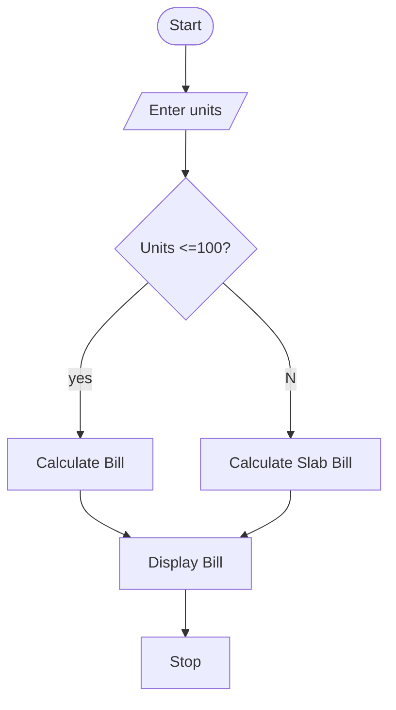

  
units = int(input("Enter electricity units: "))

if units < 0:
    print("Invalid units")
else:
    if units <= 100:
        bill = units * 2
    elif units <= 200:
        bill = 100 * 2 + (units - 100) * 3
    else:
        bill = 100 * 2 + 100 * 3 + (units - 200) * 5

    fixed_charge = 50
    surcharge = bill * 0.05
    total = bill + fixed_charge + surcharge

    if units < 50:
        total = total - 10

    print("Energy Charge: Rs.", bill)
    print("Fixed Charge: Rs.", fixed_charge)
    print("Surcharge: Rs.", surcharge)
    print("Final Bill: Rs.", round(total, 2))

Algorithm
1. Start.
2. Read electricity units.
3. Check whether units are negative.
4. Calculate the energy charge using consumption slabs.
5. Add the fixed charge.
6. Calculate the 5% surcharge.
7. Apply the rebate if units are below 50.
8. Display the final bill.
9. Stop.
Example and Sample Output
Input: 250 units
- First 100 units = 100 × ₹2 = ₹200
- Next 100 units = 100 × ₹3 = ₹300
- Remaining - 50 units = 50 × ₹5 = ₹250
- Energy charge = ₹750
- Fixed charge = ₹50
- Surcharge = ₹37.50
Output
Enter electricity units: 250
Energy Charge: Rs. 750
Fixed Charge: Rs. 50
Surcharge: Rs. 37.5
Final Bill: Rs.800
pseudocode
START
INPUT number of passengers
INPUT travel distance
INPUT travel class

FOR each passenger
    INPUT passenger age
    CALCULATE basic fare
    APPLY age-based concession
    ADD reservation fee

    IF ticket is cancelled
        APPLY cancellation penalty
    END IF

    CALCULATE final fare
END FOR

DISPLAY passenger-wise fares
DISPLAY total railway fare
STOP

Test Cases
Test Case	Input	Expected Output
1	Adult passenger	Normal fare
2	Eligible senior passenger	Concession applied
3	Different travel classes	Different fares
4	Cancelled ticket	Cancellation penalty applied

sample output:
Enter units :150
previous month Bill: Rs.400
Current month Bill: Rs.300
Bill Increase : Rs.100
Conclusion
The program calculates railway fares for multiple passengers using distance, travel class, age concessions, reservation fees, and cancellation charges.
