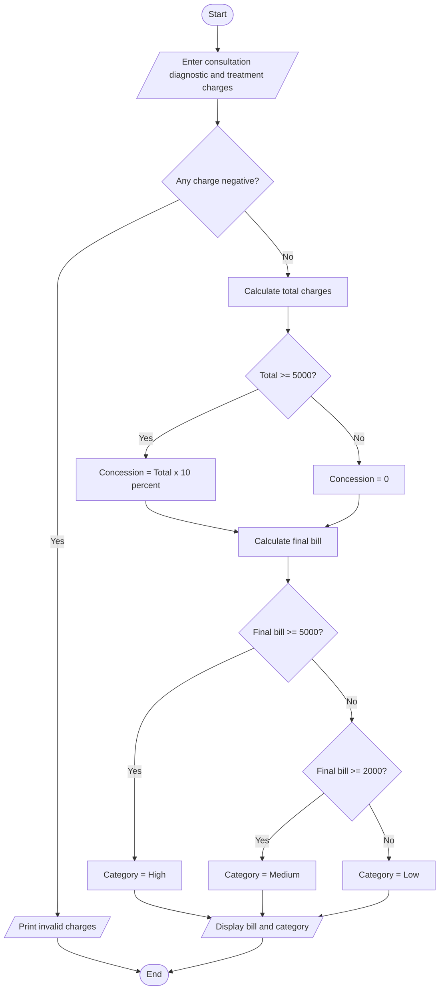

consultation = float(input("Enter consultation charge: "))
diagnostic = float(input("Enter diagnostic charge: "))
treatment = float(input("Enter treatment charge: "))

if min(consultation, diagnostic, treatment) < 0:
    print("Invalid charges")
else:
    total = consultation + diagnostic + treatment

    if total >= 5000:
        concession = total * 0.10
    else:
        concession = 0

    final_bill = total - concession

    if final_bill >= 5000:
        category = "High payment"
    elif final_bill >= 2000:
        category = "Medium payment"
    else:
        category = "Low payment"

    print("Total charges:", total)
    print("Concession:", concession)
    print("Final bill:", final_bill)
    print("Patient category:", category)
    
Algorithm
1. Start and read the three hospital charges.
2. Validate that all charges are non-negative.
3. Calculate the total charges.
4. Apply a 10% concession if the total is at least ₹5,000.
5. Calculate the final bill.
6. Classify the payment as High, Medium or Low.
7. Display the bill and category.
8. Stop.
Example and output
    Example: consultation ₹1,000, diagnostics ₹2,000 and treatment ₹3,000.

Total = ₹6,000; concession = ₹600; final bill = ₹5,400.
Enter consultation charge: 1000
Enter diagnostic charge: 2000
Enter treatment charge: 3000
Total charges: 6000.0
output
Concession: 600.0
Final bill: 5400.0
Patient category: High payment 
pseudocode

Sample output
consulation charges :500
diagnosis charges :1000
treatment charges:2500
total bill: rs.4000
concession:rs.500
final bill :rs.3500
patient classification : regular

