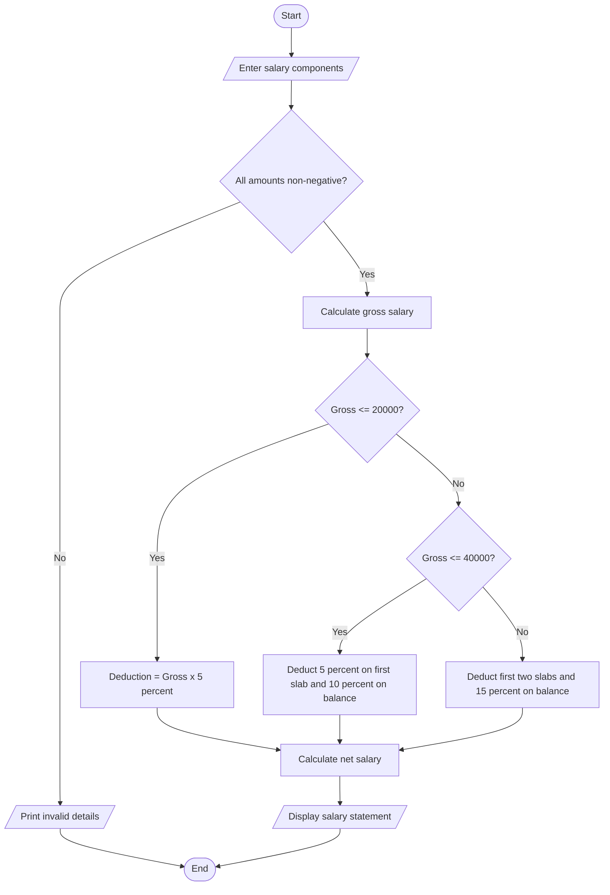

basic = float(input("Enter basic salary: "))
allowance = float(input("Enter allowance: "))
overtime = float(input("Enter overtime amount: "))
incentive = float(input("Enter incentive: "))

if min(basic, allowance, overtime, incentive) < 0:
    print("Invalid salary details")
else:
    gross = basic + allowance + overtime + incentive

    if gross <= 20000:
        deduction = gross * 0.05
    elif gross <= 40000:
        deduction = 1000 + (gross - 20000) * 0.10
    else:
        deduction = 3000 + (gross - 40000) * 0.15
net = gross - deduction

    print("Gross salary:", gross)
    print("Deduction:", deduction)
    print("Net salary:", net)

          Algorithm
1. Read basic salary, allowance, overtime and incentive.
2. Validate all amounts.
3. Add the amounts to calculate gross salary.
4. Apply progressive deductions: 5% up to ₹20,000, 10% on the next slab and 15% above ₹40,000.
5. Calculate net salary.
6. Display gross salary, deduction and net salary.
7. Stop.
Example and output
Basic = ₹25,000; allowance = ₹5,000; overtime = ₹2,000; incentive = ₹0.
Gross = ₹32,000.
Deduction = ₹1,000 + ₹1,200 = ₹2,200.
Net salary = ₹29,800.

Enter basic salary: 25000
Enter allowance: 5000
Enter overtime amount: 2000
Enter incentive: 0
Gross salary: 32000.0
Deduction: 2200.0
Net salary: 29800.0  
pseudocode
START
INPUT employee name and basic salary
INPUT allowances, overtime and incentives

CALCULATE gross salary

CALCULATE progressive deductions

CALCULATE net salary

IF salary is valid
    GENERATE salary statement
ELSE
    DISPLAY invalid salary
END IF

DISPLAY gross salary
DISPLAY total deductions
DISPLAY net salary

STOP

Test Cases
Test Case	Input / Condition	Expected Output
TC1	Basic salary with allowances	Gross salary calculated ✓
TC2	Employee has overtime	Overtime added ✓
TC3	Employee receives incentives	Incentives added ✓
TC4	Progressive deduction applies	Deduction calculated ✓
TC5	Negative basic salary	Invalid input ✗
TC6	Valid salary details	Salary statement generated ✓

Conclusion
The Employee Payroll and Deduction Analysis system calculates gross salary using basic pay, allowances, overtime, and incentives. It applies progressive deductions and generates a salary statement. This system reduces manual errors and makes payroll processing easier.

Sample output
enter basic salary : 25000
enter allowance: 5000
enter  overtime : 2000
gross salary : rs.32000
deducation : rs.3200
net salary : rs. 28800 
