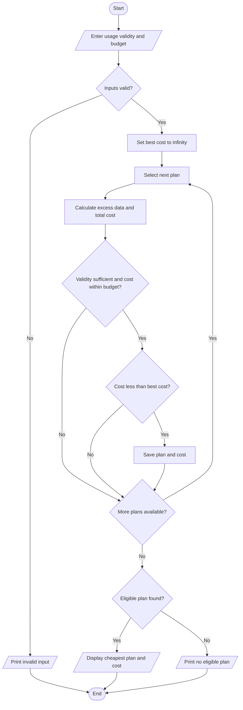

usage = float(input("Enter data usage in GB: "))
days = int(input("Enter required validity in days: "))
budget = float(input("Enter your budget: "))

plans = [
    ["Plan A", 199, 20, 28, 10],
    ["Plan B", 299, 40, 56, 8],
    ["Plan C", 399, 80, 84, 5]
]

best_plan = ""
best_cost = float("inf")

if usage < 0 or days <= 0 or budget < 0:
    print("Invalid input")
else:
    for plan in plans:
        name, price, data, validity, extra_rate = plan
        extra = max(0, usage - data)
        total = price + extra * extra_rate

        if validity >= days and total <= budget:
            if total < best_cost:
                best_cost = total
                best_plan = name
              if best_plan:
        print("Most economical plan:", best_plan)
        print("Total cost:", best_cost)
    else:
        print("No eligible plan found")  
        
 Algorithm
1. Read data usage, required validity and budget.
2. Store the details of three mobile plans.
3. Calculate excess data and total cost for each plan.
4. Check the validity and budget conditions.
5. Select the eligible plan with the lowest cost.
6. Display the selected plan and cost, or print no eligible plan.
7. Stop.
8. pseudo code
9. START
INPUT mobile usage details
INPUT budget and validity
INPUT available mobile plans

FOR each mobile plan
    CALCULATE total plan cost
    CHECK data and call usage
    CALCULATE excess charges
    CHECK budget and validity

    IF plan satisfies all conditions
        MARK plan as eligible
    END IF
END FOR

SELECT the lowest-cost eligible plan

DISPLAY eligible plans
DISPLAY most economical plan
STOP
Example and output
Input: 30 GB usage, 28 days, budget ₹350.
- Plan A: ₹199 + 10 × ₹10 = ₹299.
- Plan B: ₹299.
- Plan C: ₹399, exceeding the budget.
Plan A is selected because it is the first eligible plan with the lowest cost.

 Enter data usage in GB: 30
Enter required validity in days: 28
Enter your budget: 350
Most economical plan: Plan A
Total cost: 299.0  

Test Cases
Test Case	Input	Expected Output
1	Usage within plan	No excess charges
2	Usage exceeds data limit	Extra charges applied
3	Cost within budget	Plan eligible
4	Cost exceeds budget	Plan not eligible

Conclusion
est Cases
Test Case	Input	Expected Output
1	Usage within plan	No excess charges
2	Usage exceeds data limit	Extra charges applied
3	Cost within budget	Plan eligible
4	Cost exceeds budget	Plan not eligible

Conclusion
The program compares multiple mobile plans based on usage, validity, and budget. It calculates extra charges and identifies the most economical eligible plan.

sample output
enter montly usage: 10GB
enter budget : rs.500
plan A cost: rs.399
plan B cost : rs.499
plan C cost: rs.599
most economical plan : plan A 
total cost : rs.399
