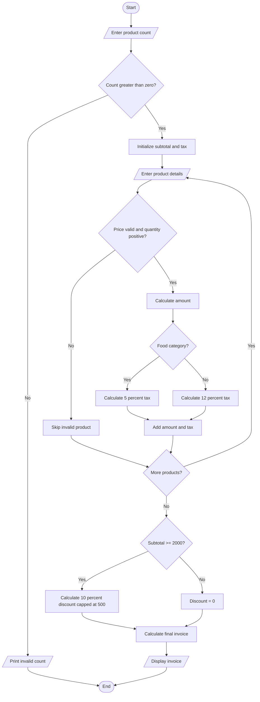

n = int(input("Enter number of products: "))
subtotal = 0
tax_total = 0

if n <= 0:
    print("Invalid number of products")
else:
    for i in range(n):
        print("Product", i + 1)
        name = input("Enter product name: ")
        price = float(input("Enter price: "))
        quantity = int(input("Enter quantity: "))
        category = input("Enter category (food/other): ").lower()

        if price < 0 or quantity <= 0:
            print("Invalid product details")
            continue

        amount = price * quantity

        if category == "food":
            tax = amount * 0.05
        else:
            tax = amount * 0.12

        subtotal += amount
        tax_total += tax

        print(name, "Amount:", amount, "Tax:", tax)

    discount = min(subtotal * 0.10, 500) if subtotal >= 2000 else 0
    total = subtotal + tax_total - discount

    print("Subtotal:", subtotal)
    print("Total tax:", tax_total)
    print("Discount:", discount)
    print("Final invoice:", total)
   Algorithm
1. Read the number of products.
2. Read each product's name, price, quantity and category.
3. Validate the product details.
4. Calculate the item amount.
5. Apply 5% tax for food and 12% tax for other products.
6. Calculate the subtotal and total tax.
7. If the subtotal is at least ₹2,000, apply a 10% discount capped at ₹500.
8. Calculate and display the final invoice.
9. Stop.
    
Example and output
Products: Rice ₹1,000 × 1 and Bag ₹1,200 × 1.
- Subtotal = ₹2,200.
- Tax = ₹50 + ₹144 = ₹194.
- Discount = ₹220.
- Final invoice = ₹2,174.
Enter number of products: 2
Product 1
Enter product name: Rice
Enter price: 1000
Enter quantity: 1
Enter category (food/other): food
Rice Amount: 1000.0 Tax: 50.0
Product 2
Enter product name: Bag
Enter price: 1200
Enter quantity: 1
Enter category (food/other): other
Bag Amount: 1200.0 Tax: 144.0
Subtotal: 2200.0
Total tax: 194.0
Discount: 220.0
Final invoice: 2174.0
pseudocode
START
INPUT number of products

FOR each product
    INPUT product name
    INPUT quantity and price
    INPUT product category

    CALCULATE subtotal
    APPLY category-specific tax
    CHECK discount conditions

    APPLY eligible discount
    CHECK maximum discount limit

    CALCULATE final product amount
END FOR

CALCULATE total bill
DISPLAY itemized invoice
STOP

Test Case	Input	Expected Output
1	Single product	Product bill generated
2	Multiple products	Total bill calculated
3	Purchase above discount limit	Discount applied
4	Purchase below discount limit	No threshold discount

Conclusion
The program generates an itemized retail bill by calculating product costs, quantities, taxes, and discounts. It applies discount limits and displays the final amount.
sample output
product: bag
quality : 2
price per item : rs.500
subtotal :rs.1000
discount:rs.100
tax: rs.90
final bill : rs.990

