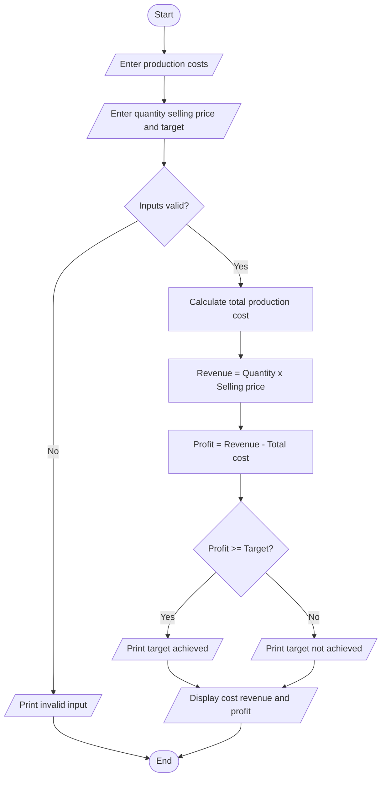

material = float(input("Enter material cost: "))
labour = float(input("Enter labour cost: "))
wastage = float(input("Enter wastage cost: "))
machine = float(input("Enter machine cost: "))
quantity = int(input("Enter units produced: "))
price = float(input("Enter selling price per unit: "))
target = float(input("Enter target profit: "))

if min(material, labour, wastage, machine, price, target) < 0 or quantity <= 0:
    print("Invalid input")
else:
    cost = material + labour + wastage + machine
    revenue = quantity * price
    profit = revenue - cost

    print("Total production cost:", cost)
    print("Total revenue:", revenue)
    print("Profit:", profit)

    if profit >= target:
        print("Profit target achieved")
    else:
        print("Profit target not achieved") 
Algorithm
1. Start.
2. Read material, labour, wastage and machine costs.
3. Read quantity, selling price and target profit.
4. Validate the input values.
5. Calculate total production cost.
6. Calculate revenue by multiplying quantity and selling price.
7. Calculate profit by subtracting total cost from revenue.
8. Compare profit with the target.
9. Display the results and stop.
    Example and output
Material = ₹5,000, labour = ₹2,000, wastage = ₹500, machine = ₹1,000, quantity = 100, selling price = ₹100 and target profit = ₹1,000.
- Total cost = ₹8,500.
- Revenue = ₹10,000.
- Profit = ₹1,500.
            Enter material cost: 5000
Enter labour cost: 2000
Enter wastage cost: 500
Enter machine cost: 1000
Enter units produced: 100
Enter selling price per unit: 100
Enter target profit: 1000
Total production cost: 8500.0
Total revenue: 10000.0
Profit: 1500.0
Profit target achieved

