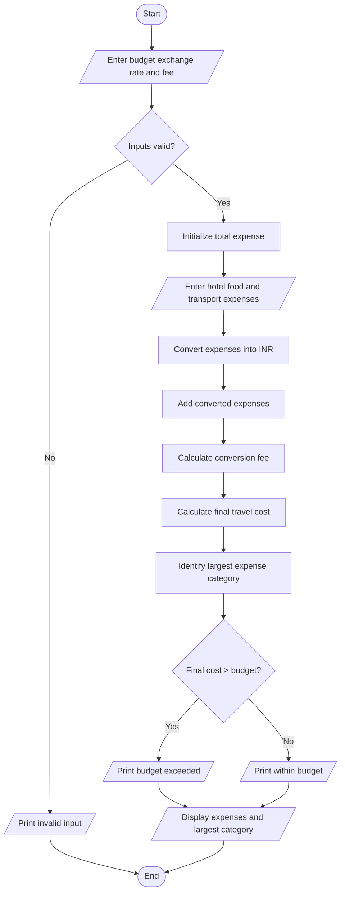

budget = float(input("Enter travel budget in INR: "))
rate = float(input("Enter exchange rate: "))
fee_percent = float(input("Enter conversion fee percentage: "))

if budget < 0 or rate <= 0 or fee_percent < 0:
    print("Invalid input")
else:
    categories = ["Hotel", "Food", "Transport"]
    expenses = []
    total = 0

    for category in categories:
        amount = float(input("Enter " + category + " expense: "))

        if amount < 0:
            print("Invalid expense")
            amount = 0

        inr = amount * rate
        expenses.append(inr)
        total += inr

    fee = total * fee_percent / 100
    final_cost = total + fee

    print("Hotel expense:", expenses[0])
    print("Food expense:", expenses[1])
    print("Transport expense:", expenses[2])
    print("Conversion fee:", fee)
    print("Total travel cost:", final_cost)

    largest = expenses.index(max(expenses))
    print("Largest expense category:", categories[largest])

    if final_cost > budget:
        print("Budget exceeded")
    else:
        print("Within budget")
     Algorithm
1. Read budget, exchange rate and conversion fee percentage.
2. Read hotel, food and transport expenses.
3. Validate the expenses.
4. Convert every expense into INR.
5. Calculate total expenses and conversion fee.
6. Calculate the final travel cost.
7. Identify the largest expense category.
8. Compare final cost with the budget.
9. Display results and stop.

Example and output
Budget = ₹20,000, exchange   rate = ₹85, fee = 2%.
- Hotel: 100 × ₹85 = ₹8,500.
- Food: 50 × ₹85 = ₹4,250.
- Transport: 30 × ₹85 = ₹2,550.
- Conversion fee = ₹306.
- Final cost = ₹15,606.
Enter travel budget in INR: 20000
Enter exchange rate: 85
Enter conversion fee percentage: 2
Enter Hotel expense: 100
Enter Food expense: 50
Enter Transport expense: 30
Hotel expense: 8500.0
Food expense: 4250.0
Transport expense: 2550.0
Conversion fee: 306.0
Total travel cost: 15606.0
Largest expense category: Hotel
Within budget

sample output
sample output
material cost :rs.50000
labour cost :rs.20000
machine cost : rs.1000
selling price :rs.12000

total cost : rs.8000
profit: rs.4000
profitability :target achieved

